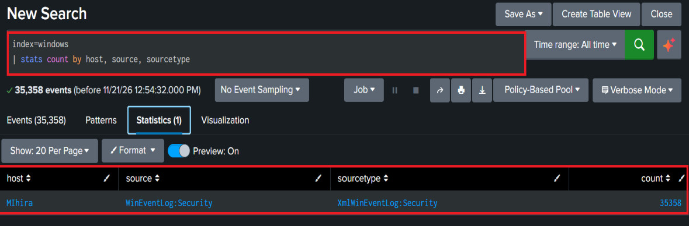
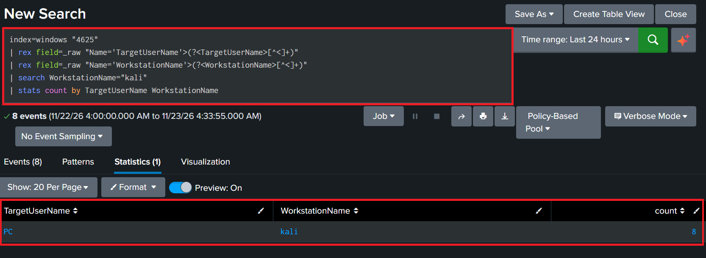
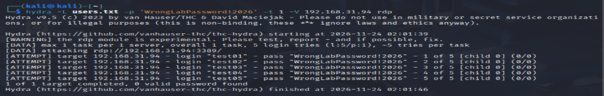

# Enterprise SOC Monitoring and Threat Detection Lab using Splunk

## Project Overview

This project demonstrates the implementation of a Security Operations Center (SOC) monitoring and threat detection lab using Splunk Cloud.

The objective was to collect Windows security logs, monitor authentication activity, identify suspicious login behaviour, and investigate security events using Splunk Search Processing Language (SPL).

The lab uses Windows as the target endpoint and Kali Linux to generate controlled authentication activity for investigation.

## System Architecture

### Architecture Components

| Component | Purpose |
|---|---|
| Kali Linux | Generates authentication attempts. |
| Windows Endpoint | Records Windows Security events. |
| Splunk Universal Forwarder | Collects and forwards Windows logs. |
| Splunk Cloud | Stores and analyzes security logs. |
| SPL Search & Reporting | Investigates events and detects suspicious activity. |

## Tools and Technologies

- Splunk Cloud
- Splunk Universal Forwarder
- Windows Security Event Logs
- Kali Linux
- Windows Remote Desktop Protocol (RDP)
- Hydra
- FreeRDP
- Splunk Processing Language (SPL)

## Implementation

### 1. Splunk Cloud Setup and Log Ingestion

- Configured a Windows index in Splunk Cloud.
- Installed and configured Splunk Universal Forwarder on the Windows endpoint.
- Enabled collection of Windows Security event logs.
- Forwarded Windows Security events to Splunk Cloud.
- Verified log ingestion using SPL.

### 2. Windows Event Investigation

- Investigated successful login events (Event ID 4624).
- Investigated failed login events (Event ID 4625).
- Inspected raw XML event data.
- Extracted authentication fields using SPL `rex`.
- Grouped failed login events by username, source IP, and logon type.

### 3. Brute-Force Detection

- Generated controlled failed authentication attempts from Kali Linux.
- Investigated Windows Event ID 4625.
- Created SPL detection logic to identify repeated failed logins.
- Applied a threshold of five failed attempts within a 15-minute window.
- Identified six failed authentication attempts against the Windows account during testing.

**MITRE ATT&CK:** T1110 – Brute Force

### 4. Password-Spraying Investigation

- Created five temporary Windows test accounts.
- Generated password-spraying activity from Kali Linux using Hydra.
- Investigated failed authentication events across multiple accounts.
- Correlated failed and successful authentication events in Splunk.
- Observed failed login attempts across five accounts followed by a successful login to `test01`.

The activity demonstrated a potential password-spraying pattern and subsequent account access.

## Key Results

- Successfully collected Windows Security logs in Splunk Cloud.
- Investigated successful and failed authentication events.
- Extracted relevant fields from raw XML event data using SPL.
- Implemented a threshold-based brute-force detection query.
- Investigated authentication activity across multiple Windows accounts.
- Used event details and timelines to support security investigation.

## Evidence

### Windows Security Event Ingestion

### Brute-Force Detection

### Password-Spraying Activity

### Authentication Event Investigation

## Documentation

The detailed lab guide contains the setup instructions, commands, SPL queries, explanations, observations, and screenshots.

[Splunk SOC Lab Guide](Documentation/Splunk-SOC-Lab-Guide.pdf)

## Project Status

Completed the core log ingestion, Windows authentication investigation, brute-force detection, and password-spraying lab activities.

Further detections and SOC investigation capabilities can be added as the lab progresses.
